<p align="center">
  <picture>
    <source media="(prefers-color-scheme: dark)" srcset="web/src/assets/nadi-logo-dark.svg">
    
  </picture>
</p>

<p align="center"><b>Camera-free live headcount per room, from Wi-Fi signals picked up by low-cost ESP32 boards.</b></p>

> On the worst day, NADI tells rescuers who is still inside. Every other day, it pays for itself.

NADI ("pulse" in Malay) tells fire wardens and the fire and rescue services (for example BOMBA in Malaysia) how many
people are still inside each room during a fire alarm or a drill. On ordinary days it shows facilities staff which
empty rooms still have the air conditioning running, and what that costs. Two ESP32 boards per room measure how the
Wi-Fi signal between them changes as people move; only a number per room leaves the room: no cameras, no names, no
phone tracking.

Built for the **Huawei ICT Competition 2026-2027 (Innovation Track)** by a team from Universiti Teknologi Malaysia
(UTM). No boards at hand? [Try it in 5 minutes](#try-it-in-5-minutes) with Docker.

## Screenshots

Screenshots use sample data; real board results are below.

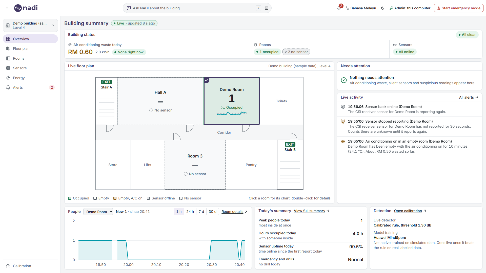

| A room's panel: count, people, signal, climate | The same in the dark theme |
|---|---|
| 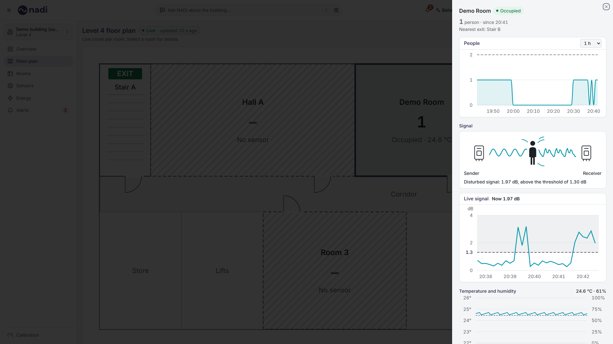 | 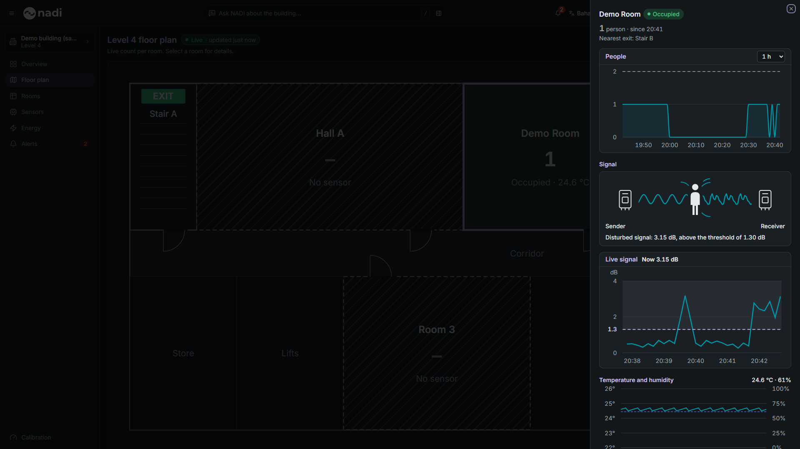 |

| | |
|---|---|
| **An empty room with the air conditioning on** | **Emergency or drill: rescue order and nearest exit** |
| 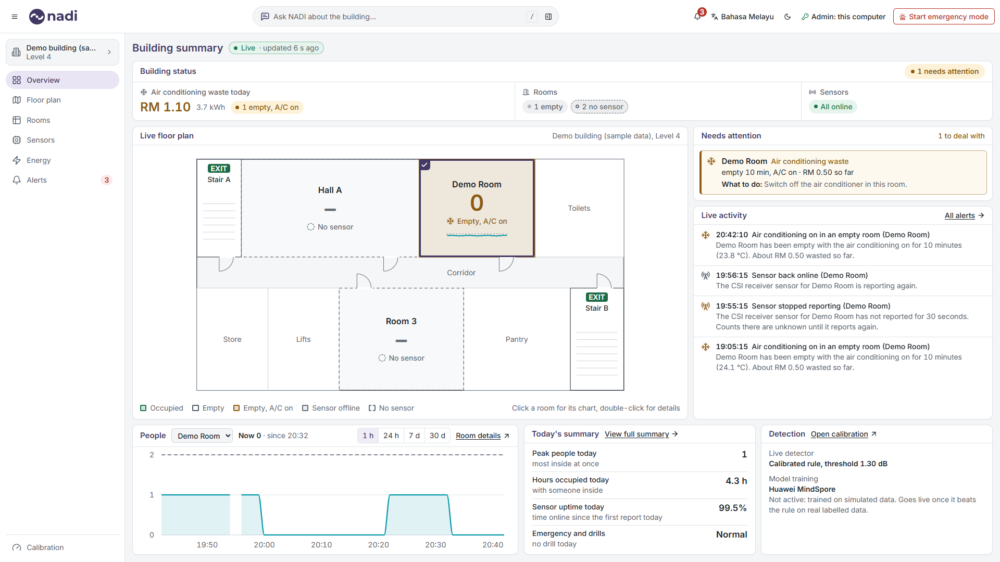 | 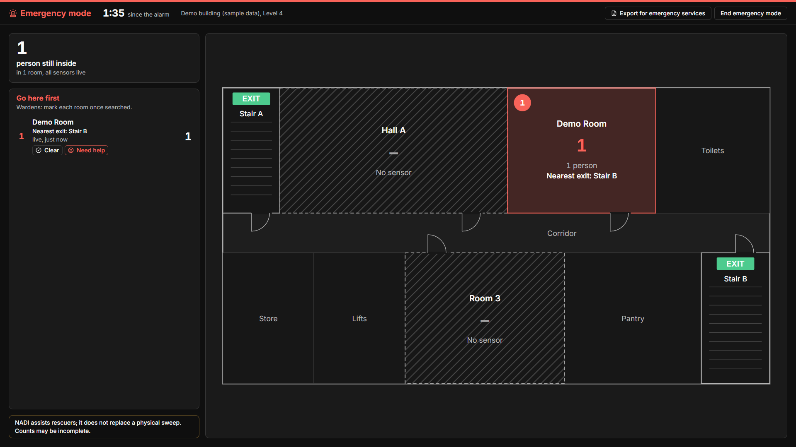 |
| **People in a room over 24 hours, with the sensor's gap** | **The same room over 7 days** |
| 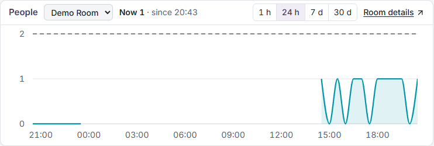 | 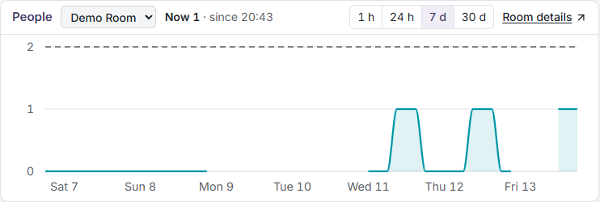 |
| **Energy: waste per day and the rooms ranked** | **Ask NADI: answers for this floor or the whole building** |
| 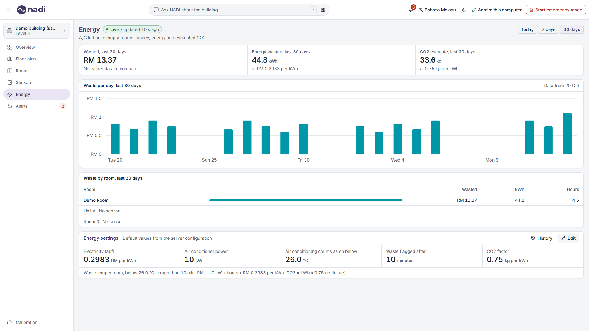 | 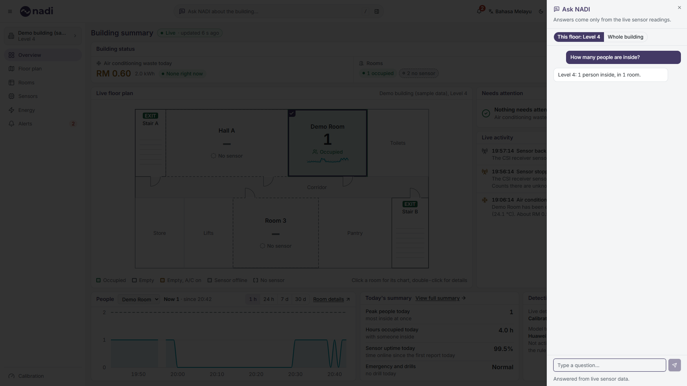 |
| **Calibration: labelled reports and the live detector** | **Floor plan editor** |
| 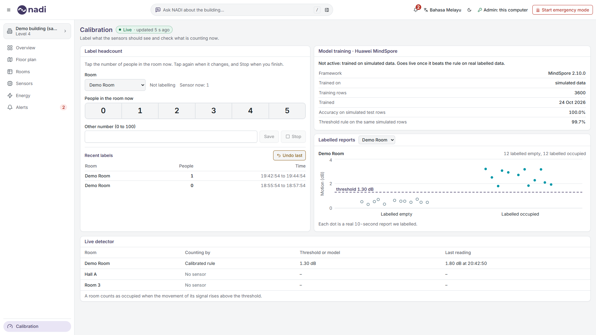 | 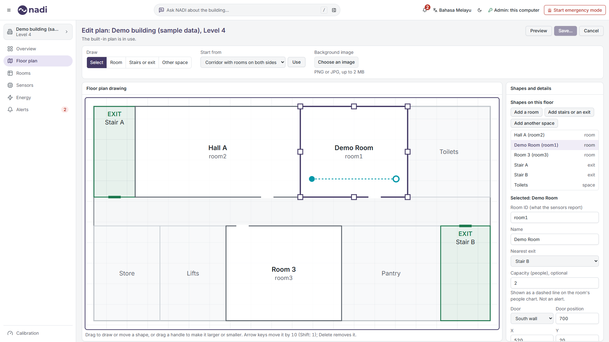 |

More: [Bahasa Melayu](docs/screenshots/redesign/overview-malay.png), [overview, dark](docs/screenshots/redesign/overview-dark.png),
[overview at 1366 x 768](docs/screenshots/redesign/overview-all-clear-1366x768.png), [floor plan](docs/screenshots/redesign/floor-plan.png), [rooms](docs/screenshots/redesign/rooms.png),
[a room with no sensor](docs/screenshots/redesign/room-no-sensor.png), [sensors](docs/screenshots/redesign/sensors.png), [alerts](docs/screenshots/redesign/alerts-full-list.png),
[energy for one room](docs/screenshots/redesign/energy-room-filter.png), [energy settings being edited, dark](docs/screenshots/redesign/energy-settings-edit-dark.png),
[people over 30 days, dark](docs/screenshots/redesign/people-card-30d-dark.png), [building and floor switcher](docs/screenshots/redesign/site-switcher-search.png),
[Ask NADI during an emergency](docs/screenshots/redesign/ask-nadi-emergency.png), [calibration on a phone](docs/screenshots/redesign/calibration-phone.png),
[sensor offline](docs/screenshots/redesign/overview-sensor-offline.png), [database offline](docs/screenshots/redesign/database-offline-banner.png).
All are made by `scripts/redesign_screenshots.py` from sample data.

## How it works

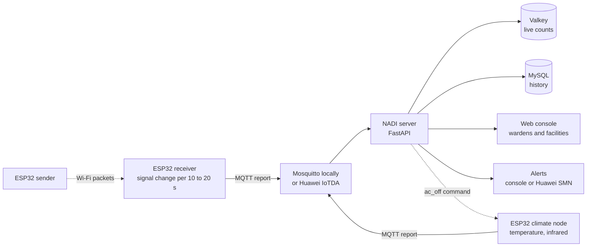

1. A sender board in each room sends small Wi-Fi packets non-stop (50 a second); a receiver board measures how the
   signal changes and sends one report per interval over MQTT, in the Huawei IoTDA message format.
2. The server checks each report and turns it into a headcount with a threshold calibrated per room (a MindSpore
   model takes over only once it beats that rule on real labelled data). Live counts go to Valkey, history to MySQL.
3. The web console draws the live floor plan; in emergency mode it lists rooms in rescue order with the nearest
   stairs. A third board reads the temperature and can send the air conditioner's own "off" code by infrared.

One sender and receiver pair tells 0, 1, 2 or "3 or more"; NADI shows "3+" and treats it as a minimum. A room whose
sensor stops reporting shows "?" with its last known count, never 0, and totals then read "at least N". More
detail: [docs/ARCHITECTURE.md](docs/ARCHITECTURE.md).

## Features

**Emergency**
- Start emergency mode or a drill from any screen; a full-screen view shows the time since the alarm, people still
  inside, and "Go here first": the rooms in rescue order, numbered on the plan, each with its nearest exit.
- Drills are marked DRILL on every screen and alert, and kept apart in the history.
- Wardens mark rooms "clear" or "need help"; the export page prints a one-page snapshot for the emergency services.
- Every emergency and drill writes its own report: how long each room took to empty, the marks, the alerts.

**Every day**
- Air conditioning waste: a room that stays empty while colder than the "counts as on" temperature is flagged after
  the waste delay, with the money, energy and an estimated CO2. Tariff, power (per building or per room),
  temperature, delay and CO2 factor are **Energy settings** an admin changes in the console; a change applies from
  the second it is saved and earlier figures keep the earlier values. The Energy page shows today (per hour), the last
  7 days or the last 30 days (per day), each set against the period of the same length before, and ranks the rooms
  (RM, kWh, hours); selecting a room filters the chart to it.
- People in a room over the last hour, 24 hours, 7 or 30 days: the highest count per step, gaps where the sensor was
  offline, and an optional room capacity as a dashed line. The room's panel adds the live signal of the last
  5 minutes against the calibrated threshold, and temperature and humidity.
- Ask NADI (English or Malay): answers come from rule-checked live numbers; a language model may only reword them.
  Answers cover the floor in view or the whole building and say which; during an emergency or drill they cover the
  whole building with a count per floor.

**Console**
- Overview, Floor plan, Rooms, Sensors, Energy, Alerts, Calibration, a summary page and Ask NADI, in English and
  Bahasa Melayu (`?lang=ms`), light and dark, keyboard accessible, nothing under 14 px.
- Buildings and floors: a switcher searches buildings, codes and floors; an example building shows how a 12-floor
  site looks (marked as example data, no sensors).
- Floor plan editor (admins): draw rooms, stairs, exits and other spaces, set each room's ID, nearest exit, sensor
  pair, floor area and optional capacity, with the same checks as the server; every save is a version that can be
  restored.

## Real test results

First tests on real boards, 2 November 2026 ([docs/REAL_TEST_RESULTS.md](docs/REAL_TEST_RESULTS.md), every number
measured, one room, boards 3 to 4 m apart):

| Test | Result |
|---|---|
| Walk test (60 s per phase) | Walking / empty `motion_std` **9.1x** (2.6316 / 0.2878 dB) |
| Calibration (2 minutes per label) | Threshold **1.301 dB** (empty versus occupied), **100% on the 23 labelled reports** |
| Live check on new data (3 phases of 40 s) | **9/9 scored reports correct** (12/12 including the unscored first reports) |
| Dashboard lag | **10.9 s** (empty to one person), **10.6 s** (one person to empty): about one report interval |
| Climate node | Settled at **24.7 °C** in an air-conditioned room; the waste alert was raised with the stage delay of 1 minute |

Known limits from the same night: a person sitting still was not tested and may read as empty; only 0 and 1 person
were calibrated; the motion figure is the spread of the signal strength (RSSI), because the CSI amplitude did not
follow people on these boards. **Not tested:** Huawei Cloud mode, MQTT over TLS, more than one room, emergency mode
with real boards, and infrared learn and send.

The MindSpore model in the repository is trained on **simulated** data and is **not** counting; the console says so
on the Calibration page and names the calibrated rule as the live detector.

## Huawei stack

Local mode is the baseline: everything below "in use now" runs on one laptop. Full table: [docs/HUAWEI_STACK.md](docs/HUAWEI_STACK.md).

| In use now | Ready, not run (needs Huawei Cloud resources) |
|---|---|
| **MindSpore** 2.10: training pipeline (`ml/train.py`); the server runs exported weights. Trained on simulated data so far, not counting live | **IoTDA** device access and data forwarding to `POST /iotda` |
| **IoTDA message format**: boards and simulator use IoTDA's topic `$oc/devices/{device_id}/sys/properties/report` and JSON, through Mosquitto | **ECS** (server), **RDS for MySQL**, **DCS for Redis** |
| **CodeArts Agent**: Huawei's coding assistant, used while building the code | **ModelArts** training jobs ([ml/MODELARTS.md](ml/MODELARTS.md)) |
| **Huawei VRP** configs for a sensor VLAN and ACL ([deploy/huawei-network/](deploy/huawei-network/README.md)), written, not run on a device | **ModelArts Studio (MaaS)** chat model, **SMN** alerts, **CodeArts** pipeline ([deploy/CODEARTS.md](deploy/CODEARTS.md)) |

Switching is a `.env` change (`NADI_MODE=huawei`); local mode makes no Huawei Cloud call even if keys are set.

## Hardware

| Part | Per room | Role |
|---|---|---|
| ESP32-S3 DevKitC-1 N16R8 | 2 (+1 for climate) | Sender and receiver (ESP-IDF, `firmware/csi_send`, `firmware/csi_recv`); climate node (Arduino, `firmware/climate_node`) |
| DHT22 | 1 | Temperature and humidity |
| KY-022 IR receiver, KY-005 IR transmitter | 1 each | Learn and send the air conditioner's "off" code |
| USB charger or power bank | per board | 5 V power |

Planned cost from the equipment checklist ([docs/NADI_Equipment_Checklist.pdf](docs/NADI_Equipment_Checklist.pdf)):
about RM31 per board, and about RM180 to 200 for the boards, sensors, breadboards and wires of the first set (rough
Shopee prices before buying, not receipts). Wiring and flashing: [firmware/README.md](firmware/README.md).

## Try it in 5 minutes

No boards, no cloud account and no Python needed: a built-in 3-minute demo story plays through the real data path
(broker, checks, Valkey, MySQL, alerts, console).

You need [Docker Desktop](https://www.docker.com/products/docker-desktop/) (running) and git.

```
git clone https://github.com/aimannurzharfan/NADI.git
cd NADI
```

Copy the example settings (they work as they are):

```
copy .env.example .env        # Windows
cp .env.example .env          # macOS, Linux
```

Start it:

```
docker compose --profile demo up --build
```

The first start downloads the images and takes a few minutes. When the log says `demo scenario: story started`,
open **http://localhost:8000** (add `?lang=ms` for Bahasa Melayu).

What you will see, on a loop of about three minutes with a purple "DEMO SCENARIO" bar at the top:

| Time | On the Overview |
|---|---|
| 0:00 | Rooms fill up: Lab 2 and Hall A reach "3+", Room 3 has 1 person |
| 0:30 | Lab 2 empties with the air conditioning still on; a minute later it turns amber and the waste starts counting in RM |
| 2:00 | Alarm: the red emergency view takes over with the rooms to check first and their nearest exits |
| 2:45 | All clear: everyone is out and emergency mode ends |

Your browser is the admin (the server only answers the computer it runs on), so you can also start a drill, open the
Sensors, Energy and Calibration pages, edit the floor plan and ask NADI a question. The numbers come from the demo
story, not from real sensors.

Stop it with Ctrl+C, then remove the containers and the demo data:

```
docker compose --profile demo down -v
```

Ports 8000, 1883, 8883, 3307 and 6379 on `127.0.0.1` must be free. The demo generates the broker passwords into your `.env`
and `deploy/mosquitto/passwd` (both ignored by git).

### Optional: Ask NADI worded by a local model

Ask NADI answers from checked rules with no model at all. To have a local model reword those answers, install
[Ollama](https://ollama.com), run `ollama pull qwen2.5:3b`, set
`OLLAMA_BASE_URL=http://host.docker.internal:11434/v1` in `.env` and start the demo again. The model may only
rephrase a checked answer; a reply that changes a number or a room is replaced by the built-in one.

### Optional: real ESP32-S3 boards

Two boards per room (sender and receiver) and one for the air conditioner. Wiring, flashing and the walk test:
[firmware/README.md](firmware/README.md) and [docs/BOARD_DAY.md](docs/BOARD_DAY.md). The boards talk to a server
started on the laptop itself, as below.

## Run from source (local mode, no cloud account)

Needs Python 3.11 or newer and Docker Desktop. Windows PowerShell:

```powershell
python -m venv .venv
.\.venv\Scripts\pip install -r requirements.txt
copy .env.example .env
.\.venv\Scripts\python scripts\mqtt_users.py          # broker logins
docker compose up -d --wait                         # Valkey, MySQL, Mosquitto
.\.venv\Scripts\python -m uvicorn server.main:app --host 127.0.0.1 --port 8000 --no-proxy-headers --limit-concurrency 200 --timeout-keep-alive 5
```

Without boards, run `.\.venv\Scripts\python sim\fake_sensor.py` in a second terminal, or set `DEMO_SCENARIO=on` in
`.env` for the fixed 3-minute story. Open http://127.0.0.1:8000 (add `?lang=ms` for Malay). The web console is
built into `web/dist` and committed, so the demo laptop needs no Node. Full guide: [docs/DEPLOYMENT.md](docs/DEPLOYMENT.md);
stage day: [docs/DEMO_RUNBOOK.md](docs/DEMO_RUNBOOK.md).

## Tests

```powershell
.\.venv\Scripts\python -m pytest                    # server, no Docker needed
cd web; npm install; npm test; cd ..                 # web console
.\.venv\Scripts\python -m pytest tests_e2e           # end to end in Microsoft Edge (Docker services running)
```

Load, attack and outage runs: [docs/TESTING.md](docs/TESTING.md). CI runs the server and web tests, a dependency
audit and a secret scan on every push (`.github/workflows/ci.yml`).

## Security and privacy

Admin actions need an admin token (or the server computer itself in local mode); cross-site requests, oversize
bodies and repeated wrong tokens are refused; console and API requests are rate-limited per address; uploaded floor plan images
are accepted only as real PNG or JPEG and stored without metadata. Only counts and aggregate signal figures leave a
room; no MAC addresses, names or raw packets are stored. Details: [SECURITY.md](SECURITY.md), [PRIVACY.md](PRIVACY.md).

## Documentation

| Document | For |
|---|---|
| [User guide](docs/USER_GUIDE.md) | Fire wardens and facilities officers |
| [Deployment guide](docs/DEPLOYMENT.md) | Installing NADI, local and Huawei Cloud mode |
| [Architecture](docs/ARCHITECTURE.md) | Components, data flow, message format |
| [Firmware](firmware/README.md), [board day](docs/BOARD_DAY.md), [data collection](docs/DATA_COLLECTION.md) | Building, flashing and labelling |
| [Demo runbook](docs/DEMO_RUNBOOK.md) | Stage day |
| [Testing](docs/TESTING.md) | Stress, attack and outage results |
| [Glossary](docs/GLOSSARY.md) | Every phrase in English and Malay |
| [Design direction](docs/design/DIRECTION.md) and [plan](docs/design/PLAN.md) | How the console looks and why |
| [Contributing](CONTRIBUTING.md), [Changelog](CHANGELOG.md) | Working on the code |

## Roadmap

- Calibrate counts above one person and a person sitting still; collect real labels and retrain the MindSpore model.
- Run more than one room, then the Huawei Cloud mode (IoTDA, ECS, RDS, DCS, SMN, MaaS) once resources are provided.
- Send the air conditioner's "off" code automatically when waste is flagged (today it is a manual command).
- Optional phase 2: device counts from a Wi-Fi access point for large halls.

## Team

Built for the Huawei ICT Competition 2026-2027 (Innovation Track) by Aiman, Mukhlis and Praveen, Universiti Teknologi
Malaysia, supervised by Dr Asri.

## Licence

Apache License 2.0, see [LICENSE](LICENSE) and [NOTICE](NOTICE). Third-party components and their licences:
[THIRD_PARTY_NOTICES.md](THIRD_PARTY_NOTICES.md).
