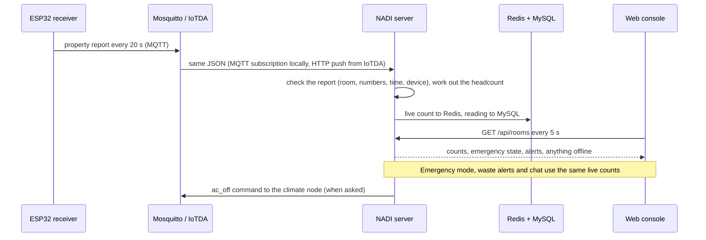

# NADI architecture

One codebase, two modes. `NADI_MODE` in `.env` decides whether NADI runs on one computer (`local`, no cloud calls at all) or on Huawei Cloud (`huawei`). The boards, the message format and the dashboard are the same in both.

## Components

| Component | What it does | Code |
|---|---|---|
| CSI sender (ESP32-S3) | Sends small Wi-Fi packets 50 times a second | `firmware/csi_send/` (ESP-IDF) |
| CSI receiver (ESP32-S3) | Reads channel state information from those packets, works out motion numbers, sends one report every 20 s | `firmware/csi_recv/` (ESP-IDF) |
| Climate node (ESP32-S3) | DHT22 temperature and humidity every 60 s; records the air conditioner remote and replays "off" on command | `firmware/climate_node/` (Arduino) |
| Broker | Receives the reports: Mosquitto locally, Huawei IoTDA in the cloud | `deploy/mosquitto/` |
| Server | Checks each report, works out the headcount, stores it, serves the dashboard and API, sends alerts, answers chat | `server/` (FastAPI) |
| Live store | Current count, temperature and emergency state per room; rate limits | Valkey, the open-source Redis (DCS for Redis in the cloud) |
| History | Every reading, for sparklines and training | MySQL (RDS in the cloud) |
| Headcount model | 0, 1, 2 or 3+ people from the motion numbers; a per-room threshold rule if no model is good enough. Large rooms can send an exact count (0 to 1000) from another counter instead | `ml/` (MindSpore), `server/model.py` |
| Web console | Overview, floor plan, rooms, sensors, energy, alerts, emergency takeover, chat, labelling page | `web/` (React, TypeScript, Tailwind, shadcn/ui), built to `web/dist`; wording and floor plan from `dashboard/strings.json` and `dashboard/plan.json` |
| Chat | Answers from rules on the live counts; a language model may only rephrase a checked answer | `server/chat.py`, `server/logic.py` |

## Data flow



If Redis, MySQL or the broker stops, the server keeps running: it serves the last known data, keeps history in memory until MySQL returns, and the dashboard shows an offline banner. See [TESTING.md](TESTING.md).

## The two modes

| | Local | Huawei |
|---|---|---|
| Broker | Mosquitto in Docker, login per device | IoTDA: MQTT over TLS, data forwarding by HTTP push to `POST /iotda` |
| Live store and history | Redis and MySQL in Docker | DCS for Redis, RDS for MySQL |
| Model training | MindSpore on the laptop | MindSpore on ModelArts ([ml/MODELARTS.md](../ml/MODELARTS.md)) |
| Chat model | Ollama on the laptop, or built-in answers | ModelArts Studio (MaaS), or built-in answers |
| Alerts | Console and dashboard | SMN (SMS and email) and dashboard |
| Hosting and deployment | The laptop | ECS, deployed with CodeArts ([deploy/CODEARTS.md](../deploy/CODEARTS.md)) |

## Message format (IoTDA)

The receiver publishes to `$oc/devices/{device_id}/sys/properties/report`:

```json
{"services":[{"service_id":"csi","properties":{
  "room_id":"room1","ts":1761800000,
  "motion_mean":0.12,"motion_std":0.05,"amp_var":0.01,"rssi_mean":-50.0,"n_packets":987}}]}
```

The climate node sends `service_id: "climate"` with `room_id`, `ts`, `temp_c` and `humidity`, and receives the IoTDA command `ac_off`. A people counter in a large room sends `service_id: "count"` with `room_id`, `ts` and `headcount` (whole number, 0 to 1000); a jump of more than 20 people within one report is held back until the next report confirms it. Every message stays under IoTDA's 4 KB limit. `ts` is 0 when the board has no clock yet; the server then uses its own. The server rejects reports with unknown rooms, numbers out of range, timestamps more than a day old or 5 minutes ahead, and rooms the device is not allowed to report for.

## Why these technologies

| Choice | Why |
|---|---|
| Wi-Fi CSI on ESP32-S3 | Counts people without cameras, using low-cost development boards. Published research reports an F1 score of about 0.96 for empty versus occupied, and 0.89 for 0 / 1 / 2+ people. |
| IoTDA message format everywhere | Moving from the laptop to Huawei Cloud changes broker settings only, not firmware or server code. |
| MQTT | Small messages and low power on the boards; the protocol IoTDA uses. |
| FastAPI | Small, fast Python server; the same language as the model training. |
| Valkey + MySQL | Valkey (BSD-3-Clause, same protocol as Redis) for the live state every screen reads every 5 s and for the per-IP limits; MySQL for history (kept 90 days) and training data. Both have managed Huawei Cloud versions (DCS for Redis, RDS). |
| MindSpore | Huawei's AI framework; the same training script runs locally and on ModelArts. The server runs the exported weights itself, so it does not need MindSpore installed. |
| Threshold rule fallback | Works on day one after a short walk test (`scripts/calibrate.py`); the model replaces it only if it does better on real data (`scripts/retrain.ps1`). |
| React + shadcn/ui console | Dense, accessible components (keyboard, focus, dialogs) for a facilities-console style; the built files are committed, so the demo laptop needs neither Node nor internet (fonts bundled). |
| Rules-first chat | In an emergency a wrong number is dangerous: the model may only rephrase an answer the rules already checked. |
