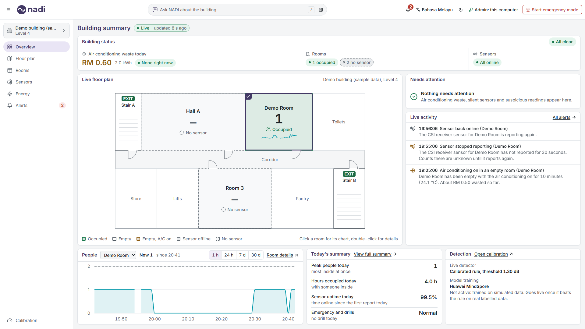
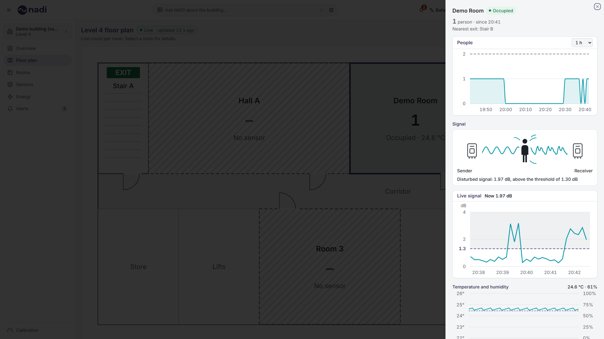
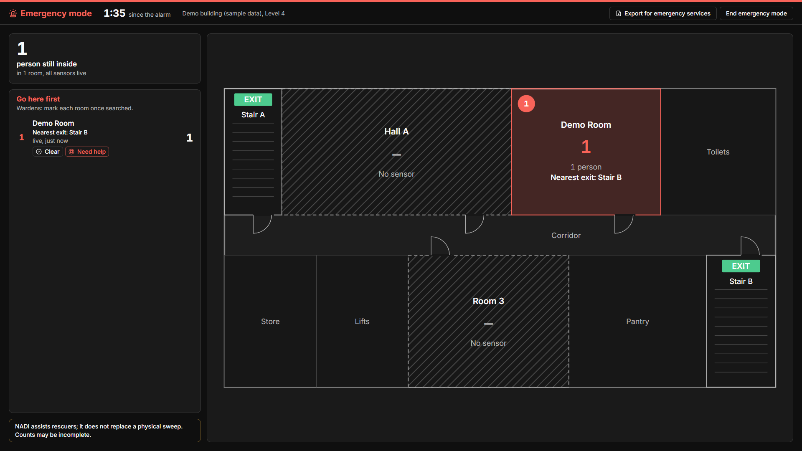
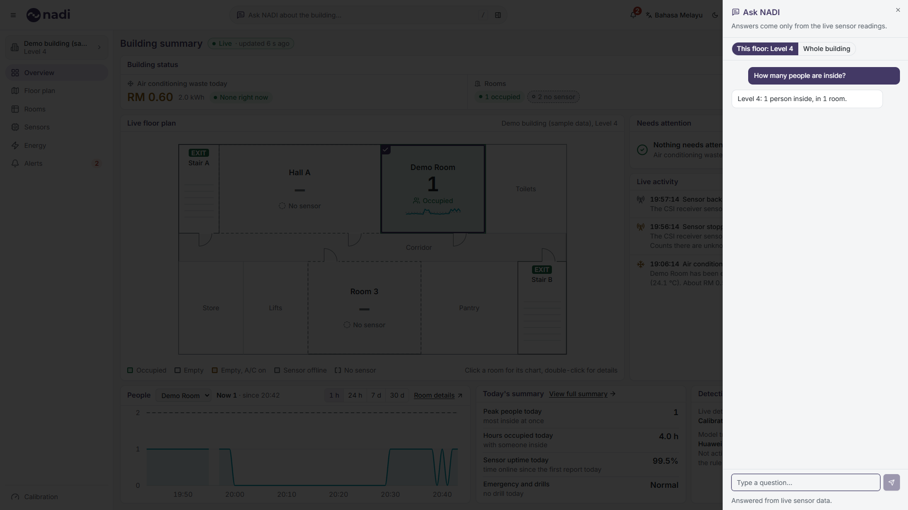
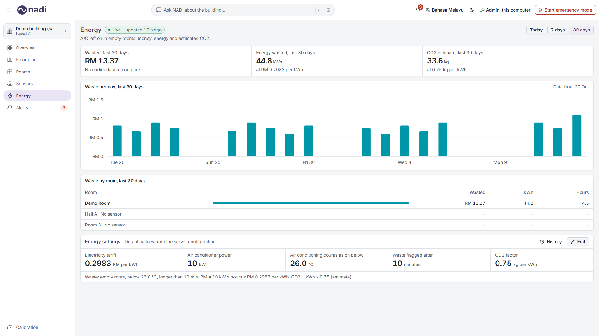
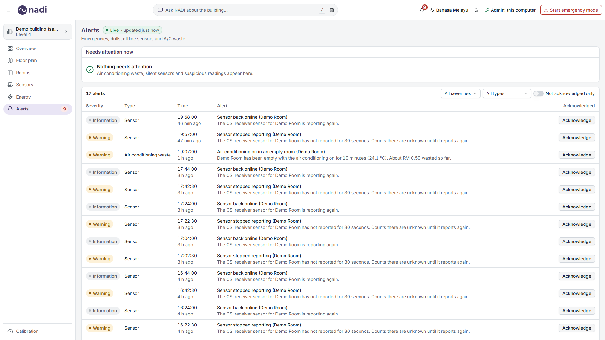
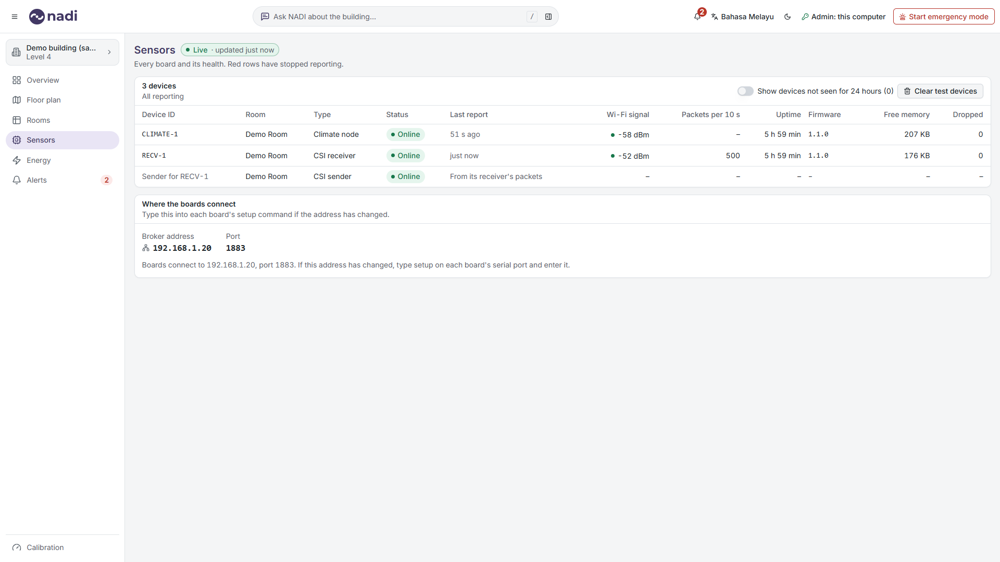
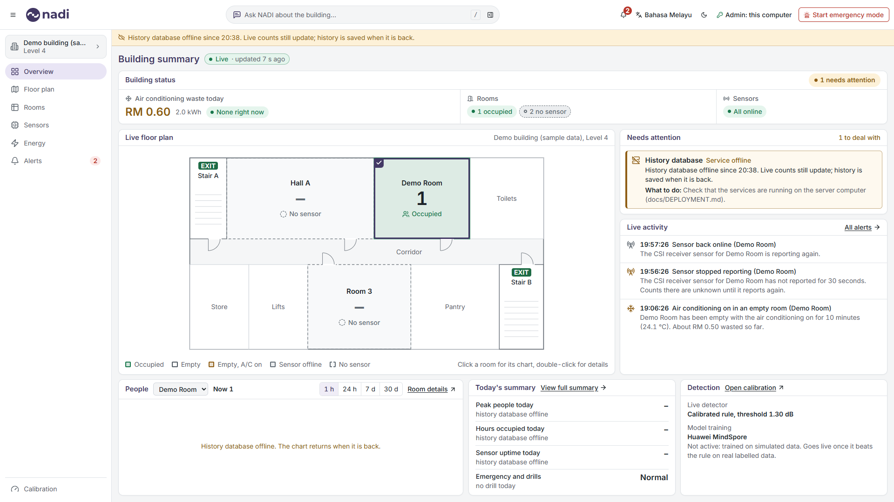
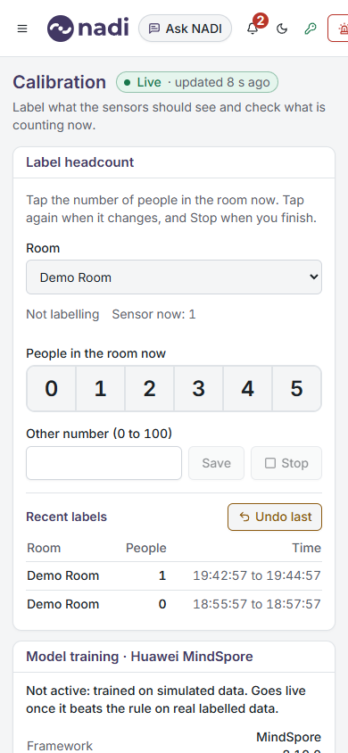

# NADI user guide

NADI counts how many people are in each room using Wi-Fi signals. No cameras, no names, no phones tracked: only a number per room leaves the room. Open the console in any browser on the building network. **Bahasa Melayu** in the top bar switches the language (or add `?lang=ms` to the address); the moon icon switches to the dark theme.

The left menu has Overview, Floor plan, Rooms, Sensors, Energy and Alerts, with the building and level above them and, for an admin, Calibration at the bottom. The menu button (three lines, top left) folds the menu to a strip of icons and opens it again; the console remembers the choice in that browser. The top bar has the **Ask NADI** box (type a question and press Enter, or press **/** to jump to it), the alerts bell with the number of alerts not yet acknowledged, the language and theme switches, whether you are signed in as an admin (with **Sign out** next to it) and **Start emergency mode**. Beside every page title, the **Live** chip says how old the newest reading is; point at it for whether NADI runs locally or on Huawei Cloud, how many rooms are reporting and the time. It turns grey and dashed and says **No live data** when no sensor is reporting. If the building manager has set a viewer token, the console asks for it first.

## For the fire warden

### Every day

- **Overview:** the building summary, read from the top. **Building status** shows air conditioning waste today (RM, kWh and whether a room is wasting now), Rooms (occupied, empty, unknown, no sensor) and Sensors (online, offline), each as a labelled pill, with one overall pill on the right: **All clear**, the number of things that need attention, or **No live data**. Below it, the live floor plan: each room with a sensor shows its count and a status word; a room without one shows "–" and "No sensor". Select a room to see its people chart below the plan; double-click it to open the room. **Needs attention** lists what to deal with and what to do; **Live activity** is the latest alerts with their times; **People** shows the selected room: the count now and since when ("Now 1 · since 06:52"), and the highest count per step over the last hour, 24 hours, 7 days or 30 days (the range buttons on the card; a list at 1366 px). A break in the line means the sensor sent nothing then; a dashed line is the room's capacity, when an admin has set one on the floor plan; "Data from 20 Oct" means the sensor has not been reporting for the whole range. **Room details** opens the room; **Today's summary** has today's peak, hours occupied, sensor uptime and any emergency or drill, and **View full summary** opens the whole day room by room; **Detection** says what is counting people right now (the calibrated rule or the MindSpore model) and the true state of the trained model. On a 1366 x 768 screen the last row is one short scroll down. Movement on this page happens only when new data arrives, and not at all during an emergency or with "reduce motion" switched on.
- **3+** means three or more people (Wi-Fi sensing cannot tell more apart). Halls with a people counter show exact numbers up to 100, then **100+**, labelled **Simulated counter (phase 2)**: today such a counter only exists in the demo.
- **?** means the room's sensor is not reporting, so its count is unknown; the last known count and how long ago are shown beside it. A room that is not reporting is never shown as empty, and totals then read "at least" with the number of unknown rooms.
- Emergency view and the export for emergency services carry the note: "NADI assists rescuers; it does not replace a physical sweep. Counts may be incomplete."
- **Floor plan:** each room shows its count and a status word. Select a room (click, or Tab then Enter) to open its panel, read from the top: the count with "since" and the nearest exit; **People** (the same chart as on the Overview, with the time range beside it); **Signal** (a picture of the sensor pair and the live signal of the last 5 minutes, with the calibrated threshold as a dashed line and a coloured mark on the axis); **Temperature and humidity**; then last update, capacity, waste today and sensor health.

### When the fire alarm sounds

1. Press **Start emergency mode** (top right), then **Start emergency mode** in the dialog. Emergency mode needs an admin: on the server computer it just works; elsewhere, sign in with the admin token first (**Sign in** in the top bar).
2. Every screen turns dark with a red bar. It shows how many people are still inside and **Go here first**: rooms with the most people first, each numbered on the plan and with its nearest exit written on the room and in the list ("Nearest exit: Stair B").
3. Read the list to the fire and rescue services (for example BOMBA in Malaysia), or press **Export for emergency services** for a one-page snapshot to print or save as PDF: who is where, the time, the building, the wardens' checks and the number to call (`EMERGENCY_NUMBER` in `.env`, default "999 (112 from a mobile phone)"). NADI also saves this snapshot on the server by itself when the alarm starts and every minute after (`data/incidents/`), as pages that open in any browser without NADI.
4. **Wardens mark each room** once searched: **Clear** (searched, nobody inside) or **Need help** (people still inside). Every screen and the export show the mark, who made it and when. **Remove mark** undoes it. Marks need an admin and are kept in the audit log.
5. A room marked **last known count, 40 s ago** (amber) has lost its sensor. Treat that number as people possibly still inside. A sensor that stops also raises a **Sensor stopped reporting** alert (critical during an emergency), and **Sensor back online** when it returns.
6. When everyone is out and the emergency services agree, press **End emergency mode**, then **End emergency mode on every screen**. The marks are cleared and a report is written: open it from **Alerts > Incident and drill reports** and print it.

### Drills

In the start dialog, **Start drill** shows exactly the same screens under a yellow **DRILL** banner. Every alert of the drill starts with [DRILL] and says it is a drill (on SMN too), and drill reports are listed apart from real incidents. Use a drill for practice and for demonstrations.

### Reports

Each emergency or drill leaves a report (Alerts page): when it started and ended and who pressed the buttons, how many people were inside at the start, how long each room took to empty, the wardens' marks, which sensors went offline and when, and every alert with who acknowledged it. **Open the last snapshot** shows the last minute snapshot. All times are Malaysia time.

### Deleting all stored data

For a personal data request (PDPA), an admin can delete every reading, label, alert, audit entry, report and snapshot: Alerts page, **Delete all stored data**, type the phrase shown, then **Delete everything**. Not possible during an emergency or a drill. Details in [PRIVACY.md](../PRIVACY.md).

### Clock warning

If the server's clock is more than a minute off internet time, a yellow bar says so: alarm times, exports and reports would carry the wrong time. Set the laptop's clock (Windows: Settings > Time & language > Sync now). Without internet there is no check and no bar.

If two wardens press start at the same time, there is still only one alarm and one start time. Who started and ended it, and when, is shown in the alerts; the admin-only audit log also keeps the IP address.

### Asking questions

Type a question in the **Ask NADI** box in the top bar and press Enter: a panel opens on the right with the answer. Type in English or Malay, for example "Which room should rescuers check first?" or "Berapa orang di dalam?". An empty panel offers three questions to try. Answers cover the floor chosen in the building switcher or, with **Whole building**, every floor; a floor or room named in the question wins, and every answer says which it covers. During an emergency or a drill answers always cover the whole building, with a count per floor. Escape closes the panel. Answers are worked out from the live counts; the chat never guesses. If the chat model is slow or off, you get the same checked answer in plain words.

## For the facilities officer

### Air conditioning left on

A room that has been empty for 10 minutes (the default) with the temperature below 26 °C shows amber on the floor plan, appears in the alerts, and counts towards the waste figures. **Energy** shows RM, kWh and an estimate of the CO2 wasted **Today**, in the last **7 days** or the last **30 days** (the buttons at the top), set against the period of the same length before, with one chart of the building's waste per hour (today) or per day, and under it the rooms ranked by waste (RM, kWh, hours). Select a room in that list to see only its waste in the chart; the chip with its name beside the chart's title removes the filter. A chart that reaches back further than the data starts at the first day with data and says so ("Data from 20 Oct"). A room on the plan without a sensor is listed as "No sensor". The **Energy settings** card below holds the tariff, air conditioner power, the temperature that counts as on, the waste delay and the CO2 factor; an admin changes them with **Edit**, and **History** lists every change. A change applies from the moment it is saved and never restates earlier days.

### Alerts

**Alerts** lists every alert with its severity (critical, warning, information) and type, with filters. An admin can **Acknowledge** an alert; every screen then shows who acknowledged it and when.

### Sensors and the board address

**Sensors** (admin only) lists every device: room, type, whether it is reporting, last report, Wi-Fi signal, packets per report, uptime, firmware, free memory and dropped readings. Rows in red have stopped reporting. Readings from the simulator are tagged **simulator**. Devices not seen for 24 hours are hidden (switch **Show devices not seen for 24 hours** to see them), and **Clear test devices** removes the simulator and those old devices from the list. Below the list, **Where the boards connect** shows the address to type into a board's `setup` command, and warns if the broker is still listening on an old address.

### When something is offline

A yellow bar under the top bar (and inside the emergency screen) says what is wrong and from what time, for example "History database offline since 16:01". It disappears by itself when the service is back. Nothing needs restarting.

| Bar says | What to do |
|---|---|
| Database offline | Check Docker Desktop is running (the `redis` container, which runs Valkey). |
| History database offline | Check the MySQL container. Live counts still work; history is saved when it is back. |
| Sensor link offline | Check the Mosquitto container and the laptop's Wi-Fi. |
| Server unreachable | The NADI program on the server computer has stopped or the network is down. |

### Teaching NADI a new room (labelling)

1. Open **Calibration** on a phone (`http://<server>:8000/calibration`; the old `/label` address opens the same page) and sign in with the admin token once.
2. Stand in the room. Tap the number of people inside (**0** to **5**), or type a larger number up to 100 and press **Save**. Tap again each time it changes. While a label runs, the sensor's own count is hidden so it cannot sway you.
3. Tap **Stop** when you finish. **Undo last** removes a wrong tap.
4. Follow [DATA_COLLECTION.md](DATA_COLLECTION.md): sessions of about 5 minutes for each headcount, sitting and walking.
5. The Calibration page shows which detector is counting right now (the calibrated rule, or the MindSpore model only when a model is active), and each labelled report as a dot against the threshold.
6. The project team then runs `scripts\calibrate.py` (sets the rule for that room) and `scripts\retrain.ps1` (trains the model; it is only used if it beats the rule).

## Demo scenario

When a **DEMO SCENARIO** banner is shown at the top of every page, the console is playing a recorded 3-minute story, not live sensor data. Ask the project team to switch it off for real use.
